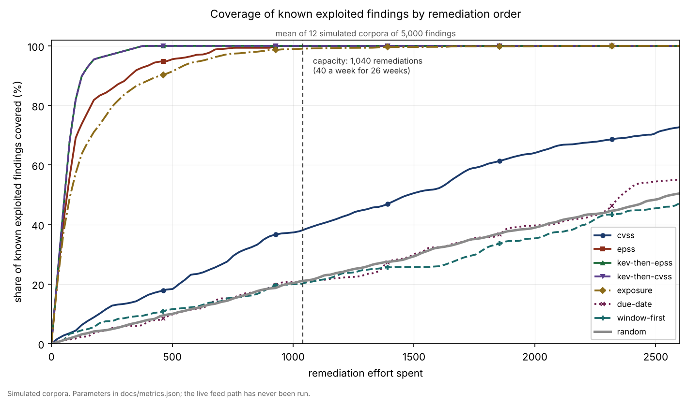

# patch-order-bench

A benchmark for the order a patch programme works in. It takes a vulnerability
backlog, spends a fixed remediation capacity against it under eight different
orderings, and scores what each one bought.

The question it exists to answer: a scanner sorts by CVSS descending, and CVSS
measures how bad a vulnerability would be if exploited, not whether anyone is
exploiting it. How much does that cost?

## Read this first

Every number published here is a simulation of
<!--number:headline.corpus.findings-->5,000<!--/number--> generated findings, not
a measurement of a real estate. The live feed path reads EPSS and the CISA KEV
catalogue, has tests against recorded responses, and has never been run against
the real endpoints.

- [Sources](sources.md) separates the one parameter with published provenance
  from the choices.
- [Limitations](limitations.md) is the list of reasons not to over read these
  figures, and it is longer than the results page.

## The result in one picture



No ordering wins on both axes. Putting the known exploited findings first covers
<!--number:headline.orderings.kev-then-epss.kev_coverage-->1.000<!--/number--> of
them and attains
<!--number:headline.orderings.kev-then-epss.window_attainment-->0.084<!--/number-->
of the reachable compliance windows. Working the windows attains
<!--number:headline.orderings.window-first.window_attainment-->0.649<!--/number-->
and covers
<!--number:headline.orderings.window-first.kev_coverage-->0.202<!--/number--> of
the exploited findings. A programme is choosing between these whether or not it
knows it is.

The full table, every spread, and the sensitivity sweep are on the
[results](results.md) page.

## Install

```bash
pip install patch-order-bench
```

```bash
pob columns findings.csv                      # see what your exporter called things
pob compare --csv findings.csv --map map.json # score all eight orderings
```

## Decisions

- [ADR 001](adr/adr-001-exploitability-ordering.md): rank by exploitation
  probability, not severity, and what the measurement actually supports.
- [ADR 002](adr/adr-002-no-persistence-layer.md): no persistence layer, and an
  argument the dependency checker falsified.
- [ADR 003](adr/adr-003-simulation-methodology.md): how the simulation earns the
  right to a number, including the striking result that turned out to be noise.
